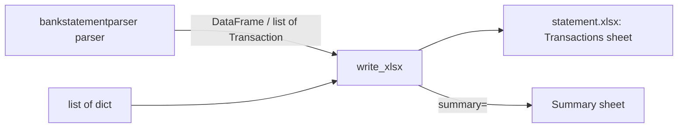

<!-- SPDX-License-Identifier: Apache-2.0 OR MIT -->

<p align="center">
  
</p>

<h1 align="center">bankstatementparser-writer-xlsx</h1>

<p align="center">
  Excel (.xlsx) writer for bankstatementparser-parsed bank statements: a bold header, one row per transaction, auto-sized columns and an optional summary sheet.
</p>

<p align="center">
  <a href="https://github.com/sebastienrousseau/bankstatementparser-writer-xlsx/actions"></a>
  <a href="https://pypi.org/project/bankstatementparser-writer-xlsx/"></a>
  <a href="https://sebastienrousseau.com/bankstatementparser-writer-xlsx/"></a>
  <a href="https://scorecard.dev/viewer/?uri=github.com/sebastienrousseau/bankstatementparser-writer-xlsx"></a>
  <a href="LICENSE"></a>
  <a href="https://github.com/sebastienrousseau/bankstatementparser-writer-xlsx/blob/main/docs/POLICIES.md"></a>
</p>

<p align="center">
  
</p>

---

## Contents

**Getting started**

- [Install](#install): PyPI, source
- [Requirements](#requirements): toolchain floor, platforms
- [Quick Start](#quick-start): parse a statement, write a workbook

**The bankstatementparser-writer-xlsx ecosystem**

- [The bankstatementparser-writer-xlsx ecosystem](#the-bankstatementparser-writer-xlsx-ecosystem): the core library, the loaders and other writers

**Library reference**

- [Capabilities at a glance](#capabilities-at-a-glance): the current surface by theme
- [Ecosystem comparison](#ecosystem-comparison): short matrix; full table at [`docs/COMPARISON.md`](docs/COMPARISON.md)
- [Benchmarks](#benchmarks): headline numbers; full table at [`docs/BENCHMARKS.md`](docs/BENCHMARKS.md)
- [Features](#features): input shapes, value coercion, errors, the summary sheet
- [Configuration](#configuration): core options
- [Examples](#examples): runnable example index

**Operational**

- [When not to use bankstatementparser-writer-xlsx](#when-not-to-use-bankstatementparser-writer-xlsx): limitations
- [Development](#development): make targets, fuzzing, CI
- [Security](#security): guarantees and compliance
- [Documentation](#documentation): all reference docs
- [Stability guarantees](#stability-guarantees): SemVer axis, output stability, minimum toolchain discipline
- [License](#license)

---

## Install

### As a Python library

```bash
pip install bankstatementparser-writer-xlsx
```

That installs the writer and pulls in `bankstatementparser >= 0.0.35`, `openpyxl` and `pandas` automatically.

| Channel | Command | Notes |
| :--- | :--- | :--- |
| PyPI | `pip install bankstatementparser-writer-xlsx` | Pulls in `bankstatementparser`, `openpyxl` 3.1 or later on 3.x, and `pandas` 2.0 or later |
| Source | `git clone https://github.com/sebastienrousseau/bankstatementparser-writer-xlsx && cd bankstatementparser-writer-xlsx && poetry install` | For development |

Verify the installation:

```sh
python -c "import bankstatementparser_writer_xlsx as w; print(w.__version__)"
# -> 0.0.37
```

---

## Requirements

- **Python 3.10 or later.** CI tests CPython 3.10, 3.11, 3.12, 3.13 and 3.14 on Linux, macOS and Windows; [`docs/POLICIES.md`](docs/POLICIES.md) says when the floor moves.
- **[`bankstatementparser`](https://pypi.org/project/bankstatementparser/) 0.0.35 or later**, whose parsers produce the `DataFrame` and `Transaction` objects the writer takes.
- **[`openpyxl`](https://openpyxl.readthedocs.io/) 3.1 or later on 3.x**, which writes the workbook, and **`pandas` 2.0 or later**.
- No network access, native extensions or system packages of its own.

---

## Quick Start

```python
from bankstatementparser import CsvStatementParser
from bankstatementparser_writer_xlsx import write_xlsx

parser = CsvStatementParser("statement.csv")
df = parser.parse()                      # a pandas DataFrame
write_xlsx(df, "statement.xlsx")         # one polished workbook
```

That's an Excel workbook ready for your accountant. Add a summary sheet
in one extra argument:

```python
from bankstatementparser import CsvStatementParser
from bankstatementparser_writer_xlsx import write_xlsx

parser = CsvStatementParser("statement.csv")
df = parser.parse()
write_xlsx(df, "statement.xlsx", summary=parser.get_summary())
```

Latest release: v0.0.37, a single `write_xlsx(data, path, ...)` function.

---

## The bankstatementparser-writer-xlsx ecosystem

bankstatementparser-writer-xlsx is one of the output writers of the `bankstatementparser` suite, whose packages ship one version together. The full table is in [The suite](docs/suite.md).

| Component | Purpose | Use case |
| :--- | :--- | :--- |
| [`bankstatementparser`](https://github.com/sebastienrousseau/bankstatementparser) | The parser core: CAMT, pain.001, CSV, OFX, QFX, MT940, MT942, BAI2 and PDF statements, and the `Transaction` model | Parsing statements from Python or the CLI |
| **`bankstatementparser-writer-xlsx`** | This writer: parsed records to an `.xlsx` workbook | Handing statements to people who work in Excel |
| Other writers | QIF, OFX and SWIFT MT940 / MT942 | Feeding accounting software and banks |
| Loaders and transport | BAI2, MT942, CFONB 120, CAMT.054, SEPA and BACS loaders; EBICS retrieval | Formats beyond the core, and fetching statements |
| [`bankstatementparser-mcp`](https://github.com/sebastienrousseau/bankstatementparser-mcp), [`bankstatementparser-lsp`](https://github.com/sebastienrousseau/bankstatementparser-lsp) | Agent tools and editor diagnostics over the core | AI agents and MT940 editing |



---

## Capabilities at a glance

| Area | Capability | Status |
| :--- | :--- | :--- |
| Input | `DataFrame`, `list[Transaction]`, `list[dict]` | Shipped |
| Values | `Decimal` as numbers, native date cells, blanks for `None` / `NaN` / missing keys | Shipped |
| Layout | Bold header, columns auto-sized and capped at 60 characters, custom sheet name | Shipped |
| Summary | `summary=` mapping written to a `Summary` sheet | Shipped |
| Core integration | Registered as the `xlsx` entry point in `bankstatementparser.writers` | Shipped |
| Number formats, frozen header, auto-filter | Formatting polish | Planned ([roadmap](ROADMAP.md)) |

---

## Ecosystem comparison

The usual alternative is pandas' own `DataFrame.to_excel`. Every cell comes from writing the same frame with both and reading the workbooks back with openpyxl.

| Project | Input shapes | `Decimal` amounts | Column widths |
| :--- | :---: | :---: | :---: |
| **bankstatementparser-writer-xlsx** | `DataFrame`, `Transaction`, `dict` | Number cells | Auto-sized, capped |
| `pandas.DataFrame.to_excel` (2.3.3) | `DataFrame` | Text cells | Default |

See [`docs/COMPARISON.md`](docs/COMPARISON.md) for the evidence and complete matrix.

---

## Benchmarks

`benches/bench_write_xlsx.py` times `write_xlsx` and measures its peak memory, which decides whether an export survives a container limit: the whole workbook is built in memory before anything reaches disk. Time per row is flat from 100 to 50,000 rows, and peak memory runs at up to 65x the size of the file written.

| Scenario | Result | Environment |
| :--- | ---: | :--- |
| 10,000 rows (445 KiB written) | 2,957 ms, 29,021 KiB peak | Apple M1 Pro, macOS 27.2.1, CPython 3.12.16 |
| 50,000 rows (2,213 KiB written) | 15,156 ms, 141,630 KiB peak | Apple M1 Pro, macOS 27.2.1, CPython 3.12.16 |
| 1,000 rows, `list[dict]` vs `DataFrame` | 283.9 ms vs 289.8 ms | Apple M1 Pro, macOS 27.2.1, CPython 3.12.16 |

See [`docs/BENCHMARKS.md`](docs/BENCHMARKS.md) for methodology and full results.

---

## Features

<!-- --8<-- [start:features] -->

### Input shapes

`write_xlsx(data, path, *, sheet_name="Transactions", summary=None)`
accepts three input shapes and normalises each to a flat table:

| Input | Column order |
| :--- | :--- |
| `pandas.DataFrame` (from a parser's `.parse()`) | the DataFrame's own column order |
| `list[bankstatementparser.Transaction]` | the stable `Transaction` field order |
| `list[dict]` | the union of keys, in first-seen order |

A header row (bold) is written to the `sheet_name` sheet, followed by
one row per record. Columns are auto-sized to their widest cell, capped
at **60 characters** so wide descriptions don't run off-screen (the cell
content itself is never truncated; only the displayed column width).

**Empty input** is accepted: an empty `list` writes an empty sheet (no
header), while an empty `DataFrame` that still carries column labels
writes a header-only sheet.

### Value coercion

Spreadsheet cells can't hold arbitrary Python objects, so the writer
coerces the rich types the parser emits:

| Python type | Written as |
| :--- | :--- |
| `decimal.Decimal` | `float` (Excel has no decimal type; floats aggregate natively) |
| `datetime.date` / `datetime.datetime` | native Excel date cell (unchanged) |
| `str`, `int`, `float`, `bool`, `None` | unchanged |
| `None` / `float('nan')` (e.g. a missing DataFrame cell) | blank cell |
| anything else | `str(value)` |

`bool` is preserved as a true/false cell (it is *not* coerced to `0`/`1`),
and a missing `list[dict]` key writes a blank cell in the same way a
`None` value does.

Every string (values, column names and the summary) is written as a
text cell holding exactly the original text: one that starts with `=`
is never stored as a formula, so a crafted transaction description
cannot become a live formula in the workbook (CWE-1236).

### Errors

`write_xlsx` validates its `data` argument and fails fast with a precise
exception rather than writing a malformed workbook:

| Condition | Raised |
| :--- | :--- |
| `data` is neither a `DataFrame` nor a `list`/`tuple` (e.g. a `str` or `int`) | `TypeError` |
| `data` is a non-empty sequence whose items are neither `dict` records nor `Transaction` objects (e.g. `[42]`) | `ValueError` |
| A value, a column name or the summary holds a control character an `.xlsx` cannot store (C0 characters other than tab, newline and carriage return) | `ValueError` |

```python
from bankstatementparser_writer_xlsx import write_xlsx

try:
    write_xlsx("not-a-table", "out.xlsx")  # a bare str is not a table
except TypeError as exc:
    print(f"rejected: {exc}")

try:
    write_xlsx([42], "out.xlsx")           # 42 is not a dict/Transaction
except ValueError as exc:
    print(f"rejected: {exc}")
```

### The summary sheet

If you pass `summary=` a mapping (for example a parser's
`get_summary()` result), the writer adds a second sheet titled
`Summary` with a bold `Key` / `Value` header and one row per item:

```python
from decimal import Decimal

from bankstatementparser_writer_xlsx import write_xlsx

transactions = [
    {"date": "2026-06-01", "description": "Salary", "amount": Decimal("3000.00")},
    {"date": "2026-06-03", "description": "Coffee Shop", "amount": Decimal("-4.20")},
]

write_xlsx(
    transactions,
    "out.xlsx",
    summary={
        "account_id": "DE89370400440532013000",
        "transaction_count": 128,
        "total_amount": Decimal("12045.67"),
        "currency": "EUR",
    },
)
```

<!-- --8<-- [end:features] -->

---

## Configuration

`write_xlsx` has two options, both keyword-only: `sheet_name` (the title of the transactions sheet, `"Transactions"` by default) and `summary` (a mapping for the optional `Summary` sheet). There is no configuration file and no environment variable. Installing the package registers `write_xlsx` under the `xlsx` name in the `bankstatementparser.writers` entry-point group, which is how the core discovers it.

---

## Examples

Six runnable examples live in [`examples/`](examples/) and are exercised in CI on every commit. Together they cover every supported input shape, option, coercion rule, and error path of `write_xlsx`:

| Example | Demonstrates |
| :--- | :--- |
| [`01_write_dataframe.py`](examples/01_write_dataframe.py) | A pandas `DataFrame` to a single sheet |
| [`02_write_transactions.py`](examples/02_write_transactions.py) | A list of `Transaction` objects in stable field order |
| [`03_write_dicts.py`](examples/03_write_dicts.py) | A list of plain `dict` records (union of keys) |
| [`04_write_with_summary.py`](examples/04_write_with_summary.py) | A DataFrame plus a second `Summary` sheet via `summary=` |
| [`05_custom_sheet_name.py`](examples/05_custom_sheet_name.py) | Renaming the transactions sheet with `sheet_name=` |
| [`06_value_coercion_and_errors.py`](examples/06_value_coercion_and_errors.py) | `Decimal`/`date` coercion, `None`/`NaN`/missing keys as blank cells, the 60-character column-width cap, and the `TypeError`/`ValueError` error paths |

Each writes to a temporary file, reads it back with `openpyxl` and leaves nothing behind:

```sh
python examples/04_write_with_summary.py
```

---

## When not to use bankstatementparser-writer-xlsx

- **You need a custom sheet layout.** The single-sheet (+ optional Summary) structure is intentionally simple. Compose your own `openpyxl` workbook if you need pivot-ready, multi-sheet layouts.
- **You need `.xls` (legacy binary).** `openpyxl` writes `.xlsx` only; convert downstream if you must.
- **You need encrypted or signed output.** Out of scope; encrypt or sign the produced `.xlsx` downstream with a tool like `msoffcrypto-tool`.
- **You want to *read* Excel.** This package is a writer.
- **You export far more rows than memory allows.** The whole workbook is built in memory first (see [Benchmarks](#benchmarks)); streaming writes are on the [roadmap](ROADMAP.md).

---

## Development

```bash
git clone https://github.com/sebastienrousseau/bankstatementparser-writer-xlsx.git
cd bankstatementparser-writer-xlsx
poetry install
make check
```

`make check` runs the local gates: `ruff` and `black`, `mypy --strict`, the complexity baseline (`scripts/check_complexity.py`), `pytest` with a 100% line + branch coverage floor, `interrogate` at 100% docstring coverage, and the examples. Other targets: `make fuzz` (Atheris, 60 s, Linux x86_64 with Python 3.12+), `make docs` (the MkDocs manual, `--strict`) and `make demo` (re-renders the GIF above with VHS from `.github/demo.tape`). CI adds the OS by Python matrix, the fuzz run, CodeQL, `pip-audit` on the locked requirements and the Docs Lint gates. Documentation and example regression tests ([`tests/test_docs_accuracy.py`](tests/test_docs_accuracy.py), [`tests/test_regression_docs.py`](tests/test_regression_docs.py), [`tests/test_regression_examples.py`](tests/test_regression_examples.py)) execute every documented snippet and every `examples/*.py` script. [`CONTRIBUTING.md`](CONTRIBUTING.md) covers branches and commit signing.

---

## Security

- **Parsed data only.** The writer consumes already-parsed records, not raw statement files; the PDF / CSV / XML parsing surface lives upstream in the [`bankstatementparser`](https://github.com/sebastienrousseau/bankstatementparser) core.
- **No formula injection.** Every string is written as a text cell, never a formula, so bank free text starting with `=` stays text (CWE-1236); `tests/test_formula_injection.py` reads the workbooks back to check it.
- **Writes only the path you give it.** `write_xlsx` creates or overwrites the one `.xlsx` at `path`; validate that path before calling it. No network, no code execution.
- **Fuzzing.** `fuzz/fuzz_write_xlsx.py` drives `write_xlsx` with Atheris in CI over fuzzed records, summaries and sheet names, and fails on any exception other than `TypeError` / `ValueError` and on a workbook that does not reopen with one row per record.
- **Supply chain.** Dependencies are locked in `poetry.lock`, CI installs hash-pinned exports of it, and `pip-audit` and CodeQL run on every change. Releases publish to PyPI through OIDC trusted publishing and carry cosign signatures, SLSA provenance and SBOMs; every workflow action is pinned by commit SHA except the SLSA generator, which must be referenced by tag.

Report vulnerabilities according to [`SECURITY.md`](SECURITY.md).

---

## Documentation

- **User manual:** [sebastienrousseau.com/bankstatementparser-writer-xlsx](https://sebastienrousseau.com/bankstatementparser-writer-xlsx/), built from [`docs/`](docs/) with MkDocs
- **API reference:** [the manual's API page](https://sebastienrousseau.com/bankstatementparser-writer-xlsx/api/), generated from the docstrings
- **Developer docs:** [`CONTRIBUTING.md`](CONTRIBUTING.md), [`ARCHITECTURE.md`](ARCHITECTURE.md), [`RELEASING.md`](RELEASING.md)
- **The suite:** [`docs/suite.md`](docs/suite.md), with every `bankstatementparser` package
- **History:** [`ROADMAP.md`](ROADMAP.md), [`CHANGELOG.md`](CHANGELOG.md)
- **openpyxl:** [openpyxl.readthedocs.io](https://openpyxl.readthedocs.io/)

---

## Stability guarantees

- **Versioning.** Releases stay on the `0.0.x` line and step by exactly `0.0.1`, in lockstep with the rest of the `bankstatementparser` suite. Under SemVer a `0.0.x` release may break anything; this project names each break in the CHANGELOG instead.
- **The breaking axis is the workbook**: the sheets written, the column order for each input shape, how each value is coerced, and which inputs raise. Changing any of them for data that wrote before is a breaking change and is called out in the CHANGELOG, even when no Python signature moves.
- **Output stability.** The writer is deterministic in its cells: the same data gives the same sheets, headers and values in the same order.
- **Python API.** `write_xlsx` and its `sheet_name` and `summary` keywords keep their names; names starting with `_` are internal.
- **Minimum toolchain.** Python 3.10 is the floor; it moves only in a release, for the whole suite at once, with the reason in the CHANGELOG ([`docs/POLICIES.md`](docs/POLICIES.md)).

---

## License

Dual-licensed under [Apache License, Version 2.0](LICENSE-APACHE) or [MIT](LICENSE-MIT), at your option (`SPDX-License-Identifier: Apache-2.0 OR MIT`). Built on [openpyxl](https://openpyxl.readthedocs.io/) and the core [`bankstatementparser`](https://github.com/sebastienrousseau/bankstatementparser) library. Any contribution submitted for inclusion in the work shall be dual-licensed as above, without additional terms or conditions.
